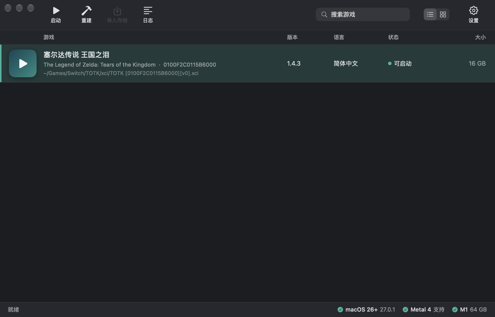
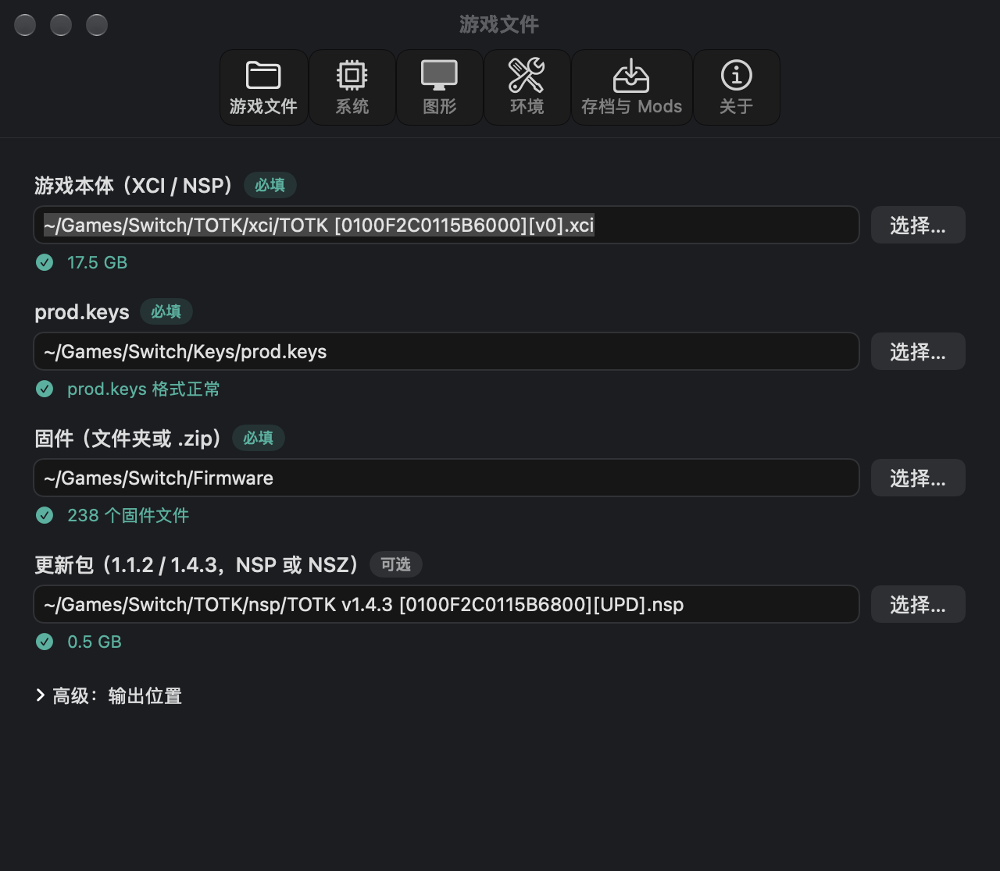
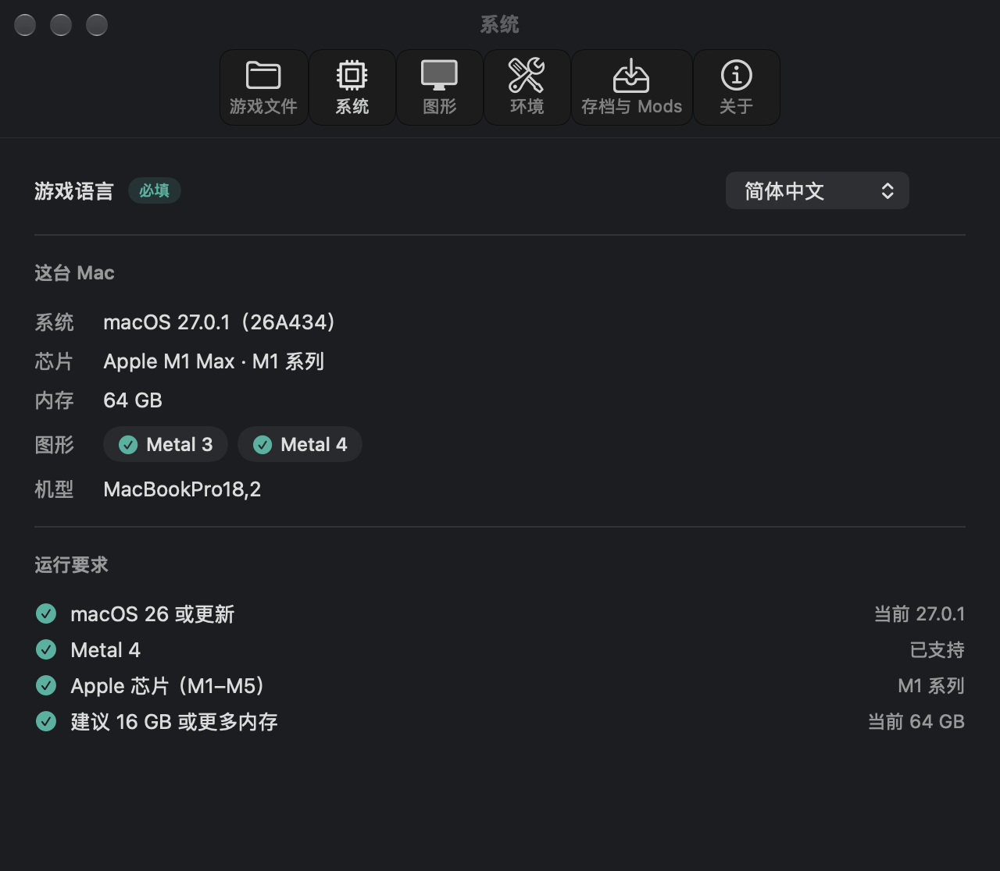
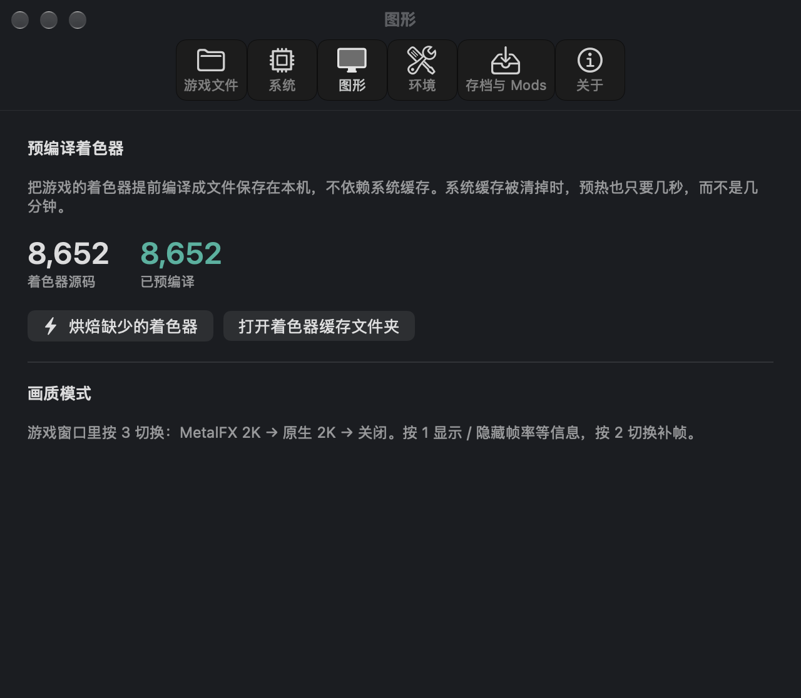
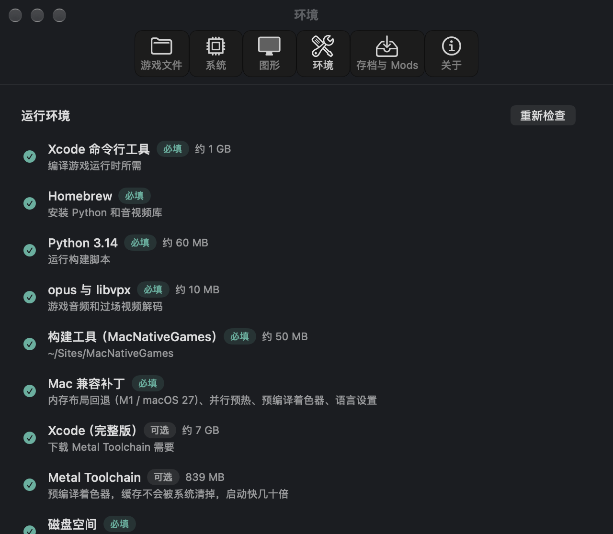

# Switch macOS Launcher · 王国之泪 启动器

[中文](#中文) · [English](#english)



---

## 中文

一个 Ryujinx 风格的 macOS 启动器，用来在 **Apple 芯片 Mac** 上构建并运行**你自己拥有的**游戏。

> **目前暂时只支持《塞尔达传说 王国之泪》（TOTK）。** 仓库名里的 “switch” 是预留给以后的，别的游戏现在不能用。

本项目**基于 [MacNativeGames](https://github.com/ly05010419/MacNativeGames)（MIT，作者 ly05010419）衍生**：构建与运行游戏的核心全部来自它；本仓库提供图形化启动器，以及一份针对 M1 / macOS 27 的兼容与加速补丁。

### 重要声明（请务必阅读）

- **不含任何游戏内容。** 本仓库和 Release 里没有游戏本体、`prod.keys`、固件，也没有游戏封面等素材。
- **游戏必须由你自己从你自己的 Switch 中获取**，包括游戏本体（XCI / NSP）、`prod.keys` 和固件。
- **不得分发、不得出售**游戏、密钥、固件，或用本项目构建出来的包含游戏数据的 App。**仅限个人使用。**
- 本项目与任天堂无关，《塞尔达传说》及相关名称、商标归任天堂所有。

### 截图

| 游戏文件 | 系统 |
|---|---|
|  |  |

| 图形（预编译着色器） | 环境 |
|---|---|
|  |  |

### 功能

- **游戏库界面**：深色、工具栏（启动 / 构建 / 导入存档 / 日志）、搜索、列表 / 网格、底部状态栏；支持把 `.xci` / `.nsp` 直接拖进窗口。
- **系统检测**：macOS 版本、芯片（M1–M5 系列）、内存、Metal 3 / Metal 4；顶部和状态栏明确写出 **macOS 26+、Metal 4** 的要求，不满足时给出"不支持"。
- **环境检查与后台安装**：检查 Xcode 命令行工具、Homebrew、Python 3.14、opus / libvpx、构建工具、**Metal Toolchain（839 MB）**、磁盘空间；缺什么就给"安装"按钮，后台下载并显示进度。每一项都要你点击才会执行。
- **语言**：12 种，**默认简体中文**。游戏本体自带简体 / 繁体等文本，不需要额外的汉化补丁。
- **存档**：选择存档文件夹后一键导入，**覆盖前自动备份**。
- **构建**：调用 MacNativeGames 的构建脚本，显示 4 步进度；自动准备一份清理过的 `prod.keys` 副本（去掉会让 hactool 报错的行，原文件不动）。
- **启动**：检测到"内存地址预留失败"时自动重试（见下文），不用手动再开。

### 相对上游的改进（`totk-mac-fixes.patch`）

补丁只涉及 3 个文件，基于上游提交 `41e1e0c`；启动器下载构建工具时会**固定到该提交并自动应用补丁**。

| 改进 | 说明 | 实测（M1 Max，8290 个着色器） |
|---|---|---|
| **多线程着色器预热** | 另开多个线程提前把着色器源码交给系统编译服务。默认 6 线程，`TOTK_WARM_THREADS` 可调（设为 1 关闭）。 | 编译速度约每分钟 800 个，单线程约 150–200 个（含部分系统缓存命中，倍数仅供参考）。 |
| **持久着色器缓存** | 把每个着色器预先编译成 `.metallib` 文件放在本机，不依赖会被其他 Metal 程序挤掉的系统缓存。需要 Metal Toolchain。 | 系统缓存冷时的预热：单线程约 40 分钟（按速度估算）→ 多线程约 8 分钟 → 用预编译库后首次约 23 秒，之后稳定约 7 秒。 |
| **内存布局回退** | 部分 Mac 上游戏要的固定地址段无法预留。默认布局放不下时，回退到"栈、堆、alias 并排"的单块布局（alias 默认 12 GiB）。 | 在 M1 Max + macOS 27 上让游戏能启动；该机器上观察到约一半的启动会预留失败，启动器会自动重试。 |
| **语言设置文件** | 双击启动的 App 读不到环境变量，改为读取 `~/Library/Application Support/MacNativeGames/TOTK/language.txt`。 | — |

### Mods 与其他尚未实现的事

- **Mods：入口已预留，暂未实现。** 游戏运行时目前没有 Mods 加载器，设置里的 Mods 路径只会被保存，不会被应用（界面上标着"暂不生效"）。欢迎贡献。
- 默认画质档（MetalFX）在测试机上显示黑屏；在游戏窗口里按 `3` 切换画质档后可以显示。尚未修复。
- 在游戏里：`1` 显示 / 隐藏帧率等信息，`2` 切换补帧，`3` 切换画质。

### 系统要求

- **macOS 26 或更新**，**Metal 4**，Apple 芯片（M1–M5），建议 16 GB 或更多内存，构建需要约 25–40 GB 空闲磁盘。
- 启动器本身以 macOS 15 为部署目标，但游戏核心要求 macOS 26+ 与 Metal 4：在更旧的系统上启动器只会显示"不支持"。
- **测试范围**：只在 **MacBook Pro（M1 Max，64 GB）+ macOS 27.0.1** 上测过。其他芯片、其他系统版本和 8 GB 内存**没有验证**。
- 启动器里的构建、启动、导入存档和各个"安装"按钮的完整点击流程，作者只在命令层面验证过，界面上的整条流程没有逐项点过，遇到问题请提 issue。

### 安装

1. 到 [Releases](https://github.com/elisezhu123/switch-macos-launcher/releases) 下载 `TOTK-macOS-Launcher-v*-arm64.zip`，解压，拖到"应用程序"。
2. **移除隔离属性（quarantine）。** 这个 App 没有 Apple 开发者签名和公证（只是本地临时签名），从浏览器下载后会被 macOS 拦截，需要在终端运行：

   ```bash
   xattr -dr com.apple.quarantine "/Applications/王国之泪启动器.app"
   ```

   也可以右键 → 打开，再在系统设置 → 隐私与安全性里点"仍要打开"。
3. 打开 App → 设置（⌘,）→ 填入游戏本体、`prod.keys`、固件 → 在"环境"页把缺的东西装好 → 回到主窗口点"构建" → 构建完成后点"启动"。

### 从源码构建

需要 Xcode（或命令行工具里的 `swiftc`）：

```bash
./build.sh                       # 生成 王国之泪启动器.app
./scripts/make-release.sh 1.0.0  # 构建、去掉 quarantine、打 zip 和校验和（输出到 dist/）
```

### 目录

| 文件 | 作用 |
|---|---|
| `Launcher.swift` | 启动器全部代码（SwiftUI） |
| `totk-mac-fixes.patch` | 对 MacNativeGames 的补丁（内存回退、多线程预热、预编译着色器、语言设置、烘焙脚本） |
| `build.sh` / `scripts/make-release.sh` | 构建与发布 |

### 致谢

- **特别感谢 [ly05010419](https://github.com/ly05010419) 大佬和他的 [MacNativeGames](https://github.com/ly05010419/MacNativeGames)。** 让游戏能在 Apple 芯片 Mac 上原生运行的核心工作都是他完成的：改写游戏代码、Switch 系统服务、把 NVN 图形接到 Metal。没有他的项目，就没有这个启动器；本仓库只是在它之上做了一层图形界面和几处兼容与加速补丁。
- MacNativeGames 又建立在 d2r-mobile、nxnative、Ryujinx 的着色器翻译、SPIRV-Cross、deko3d 等项目之上，详见它的仓库，在此一并感谢。
- 界面风格参考了 Ryujinx。

### 许可与使用范围

- 本仓库的代码以 MIT 许可发布，见 [LICENSE](LICENSE)（`totk-mac-fixes.patch` 是对 MacNativeGames 的修改，保留其 MIT 版权声明）。
- **目前仅支持 TOTK。** 游戏必须由你自己从自己的 Switch 中获取，**不可分发、不可出售，仅限个人使用**。
- 《塞尔达传说》及相关名称、商标归任天堂所有，本项目与任天堂无关，也不分发游戏、密钥或固件。

---

## English

A Ryujinx-style macOS launcher for building and running **your own copy** of a game on **Apple silicon Macs**.

> **Only *The Legend of Zelda: Tears of the Kingdom* is supported for now.**

It is **derived from [MacNativeGames](https://github.com/ly05010419/MacNativeGames) (MIT) by [ly05010419](https://github.com/ly05010419)**, who did the real work of making the game run natively. Many thanks! This repository adds a native launcher plus a small patch for M1 / macOS 27.

> **No game content is included.** The game file (XCI/NSP), `prod.keys` and firmware must be obtained **by you, from your own Switch**. **Do not distribute or sell** them or any app built from them — **personal use only.** Not affiliated with Nintendo.

**Features**: game-library window (drag & drop `.xci`/`.nsp`), system detection (macOS 26+, Metal 4, M-series, RAM), environment check with background installers (including the 839 MB Metal Toolchain), 12 game languages (Simplified Chinese by default), save import with automatic backup, build progress, and automatic retry when the game fails to reserve its address space.

**Patch (`totk-mac-fixes.patch`, against upstream commit `41e1e0c`)**: multi-threaded shader pre-warming (6 threads by default, `TOTK_WARM_THREADS`), a persistent precompiled shader cache (`.metallib` files that other Metal apps cannot evict), a memory-layout fallback for Macs where the default fixed addresses cannot be reserved, and a `language.txt` setting.

**Not implemented**: **mods** — the field is reserved in the UI but the game runtime has no mod loader yet, so nothing is applied. The default MetalFX picture mode showed a black screen on the test machine (press `3` in-game to switch).

**Requirements**: macOS 26+ and Metal 4 (the launcher itself targets macOS 15 but will report "unsupported" on older systems), Apple silicon, 16 GB+ recommended. Tested only on an M1 Max / 64 GB / macOS 27.0.1.

**Install**: download the zip from Releases, move the app to Applications, then remove the quarantine attribute (the app is ad-hoc signed, not notarized):

```bash
xattr -dr com.apple.quarantine "/Applications/王国之泪启动器.app"
```

Build from source with `./build.sh`; produce a release zip with `./scripts/make-release.sh`. MIT licensed (see [LICENSE](LICENSE)).
