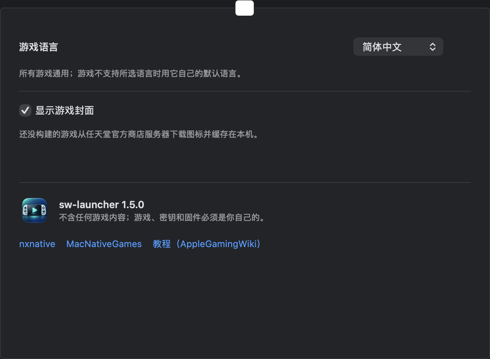
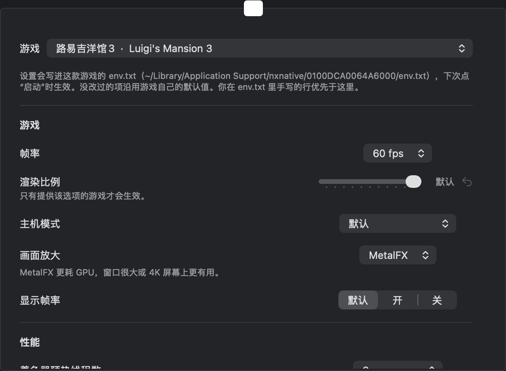
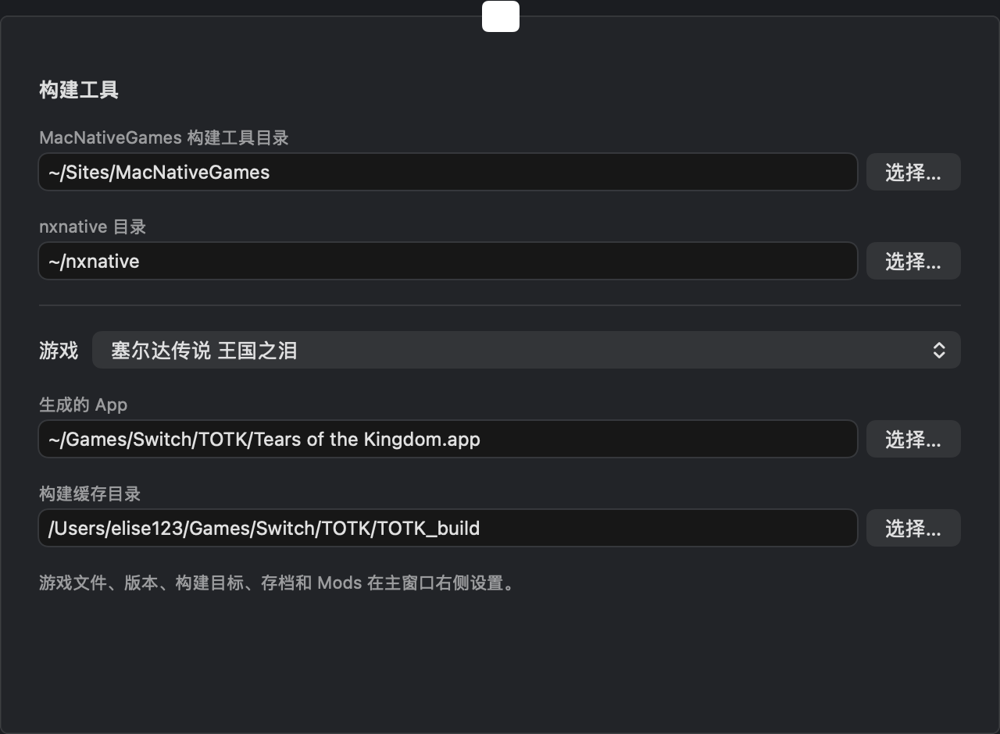

# sw-launcher · Switch macOS Launcher

[中文](#中文) · [English](#english)


---

## 中文

一个 Ryujinx 风格的 macOS 启动器，用来在 **Apple 芯片 Mac** 上构建并运行**你自己拥有的**游戏。

> **两个后端，共 71 个条目：**
> - **MacNativeGames**：《塞尔达传说 王国之泪》（1.0.0 / 1.1.2 / 1.4.3）和《旷野之息》（1.9.0，实验性）。保留原有的多线程着色器预热、预编译烘焙和 RomFS Mods。
> - **nxnative**（[seedds/nxnative](https://github.com/seedds/nxnative)，见 [AppleGamingWiki 教程](https://www.applegamingwiki.com/wiki/Nxnative_Switch_to_Mac_conversion)）：**69 款游戏**，每款按它的档案支持对应版本，例如《超级马力欧兄弟 惊奇》1.0.0 / 1.0.1 / 1.2.1、《路易吉洋馆3》1.4.0、《火焰纹章 Engage》2.0.0、《怪物猎人 崛起》16.0.2。完整列表在启动器的游戏库里，装好 nxnative 后点“更新 nxnative 与游戏列表”还会自动读到它新增的游戏和版本。
>
> v1.2.0 加入 nxnative 后端；v1.4.0 重做主窗口（分类、游戏详情面板），缺少的组件自动后台安装，并换了新图标；v1.5.0 加入一键安装、国内镜像，详情面板里可直接管理存档和 Mods。旧版设置自动沿用，已经构建好的 App 不用重新构建。

### 重要声明（请务必阅读）

- **不含任何游戏内容。** 本仓库和 Release 里没有游戏本体、`prod.keys`、固件，也没有游戏封面等素材。游戏库里的封面是运行时从任天堂官方商店服务器下载并缓存在本机的图标（设置 → 通用 可关闭）；已构建的游戏用从你自己的文件里解出的图标。
- **游戏必须由你自己从你自己的 Switch 中获取**，包括游戏本体（XCI / NSP）、`prod.keys` 和固件。
- **不得分发、不得出售**游戏、密钥、固件，或用本项目构建出来的包含游戏数据的 App。**仅限个人使用。**
- 本项目与任天堂无关，《塞尔达传说》及相关名称、商标归任天堂所有。

### 截图

游戏文件、版本、构建目标、存档和 Mods 都在主窗口右侧的详情面板里。设置（⌘,）只剩四页：

| 通用（语言、封面） | 游戏（帧率、线程等） |
|---|---|
|  |  |

| 环境 | 高级（目录） |
|---|---|
|  |  |

### 功能

- **游戏库界面**（v1.4.0 重做）：左侧按“全部 / 已添加 / 可启动”和引擎（MacNativeGames、nxnative）分类；中间列表只显示名称、引擎、版本和状态；右侧是选中游戏的详情——**选择版本**（据此判断要不要更新包，并检查更新包版本是否对得上）、**点击添加**游戏本体 / 更新包 / DLC / prod.keys / 固件、**选择构建目标**（Mac / iPad·iPhone Xcode 工程 / IPA），构建和启动按钮固定在底部。也支持把文件直接拖进窗口（文件名里带游戏 ID 时会自动选中对应的游戏和版本）。
- **两款游戏互不干扰**：存档、着色器缓存、日志分别放在 `~/Library/Application Support/MacNativeGames/<TOTK|BOTW>/` 和 `~/Library/Logs/MacNativeGames/<totk|botw>.log`。同一时间只能运行一款；另一款在运行时，启动器会提示，不会去关掉它。
- **Mods**：支持替换游戏文件的 RomFS mod，见下文。
- **系统检测**：macOS 版本、芯片（M1–M5 系列）、内存、Metal 3 / Metal 4；顶部和状态栏明确写出 **macOS 26+、Metal 4** 的要求，不满足时给出"不支持"。
- **环境检查与后台安装**：检查 Xcode 命令行工具、Homebrew、Python 3.14、opus / libvpx、构建工具、**Metal Toolchain（839 MB）**、磁盘空间；缺什么就后台下载并显示进度。v1.4.0 起默认**自动在后台安装**不需要密码的组件（按顺序、前置条件就绪后逐个安装，失败不自动重试，左下角可关闭）；Homebrew、命令行工具、.NET、Xcode 需要密码或 App Store，列在左下角，点“安装”在“终端”里运行。v1.5.0 起有**一键安装全部**：需要密码的几项合进一个“终端”窗口依次执行，只输一次密码；Xcode 打开 App Store；其余在后台安装。
- **下载源**（v1.5.0，设置 → 环境）：自动 / 官方源 / 国内镜像。自动 = 没有代理、或 PyPI / GitHub 4 秒内没响应时走镜像（Homebrew 与 PyPI：清华 TUNA；Homebrew 安装脚本：中科大；git：ghfast.top，第三方代理）。NuGet（nxnative 解包工具 nx_extract 的依赖）除非选“总是用官方源”，一律走华为云镜像，因为 api.nuget.org 时常断连。MacNativeGames 按提交哈希下载，镜像改不了内容。系统代理会传给所有安装和构建命令。
- **语言**：12 种，**默认简体中文**。游戏本体自带简体 / 繁体等文本，不需要额外的汉化补丁。
- **存档**：选择存档文件夹后一键导入，**覆盖前自动备份**。
- **构建**：调用 MacNativeGames 的构建脚本，显示 4 步进度；自动准备一份清理过的 `prod.keys` 副本（去掉会让 hactool 报错的行，原文件不动）。
- **启动**：检测到"内存地址预留失败"时自动重试（见下文），不用手动再开。重试时只等上一次启动自己退出，不会结束任何进程。

### nxnative 后端（v1.2.0）

- **构建**：游戏本体 + 对应版本的更新（文件名要带 `[v版本号]`）+ 可选 DLC + `prod.keys`，**不需要固件**。启动器用 `scripts/build_ipa_from_nsp.py --platform mac-app --progress json` 构建，进度条读它的 JSON 事件；游戏文件只做符号链接（nxnative 要求一个文件夹一款游戏），不复制。
- **环境**：Xcode（选用并同意许可）、Metal Toolchain、git / zstd / spirv-cross / lz4 / glslang、.NET SDK 10、nxnative 本体，以及装在启动器自己 Python 环境里的 capstone / fonttools / lz4 / nsz。每一项都要你点“安装”。
- **多线程**：设置 → 游戏里的“着色器预热线程数”写成 `DM_PSO_PREPARE_THREADS`（默认等于 CPU 核心数）。
- **Mods**：沿用同一份 mods 列表（开关、顺序、冲突），启动时转成 nxnative 自带的 `DM_ROMFS_OVERLAY`：先读 mod 里的文件，没有的再读原版；不用重新构建。
- **其他设置**（帧率 30/60、渲染比例、主机/掌机、MetalFX、手柄震动、Metal 4 管线等）按游戏保存，写进 `~/Library/Application Support/nxnative/<标题ID>/env.txt` 里启动器自己的那一段；你手写在段外的行优先。语言只在游戏支持时写入（读构建时解出的 `control.nacp`）。
- **iPad / iPhone**（v1.2.0）：主窗口右侧“构建目标”可选 iPad/iPhone（Xcode 工程，推荐）或 IPA。Xcode 工程：构建完自动打开，登录自己的 Apple ID（免费的也行）、选 Personal Team、连上 iPad 点 Run；免费账号签名 7 天过期，重新 Run 即可，且不能申请“增大内存限制”（大型游戏可能被系统关闭）。IPA：用 Sideloadly / AltStore 签名安装。iOS 构建需要 Xcode，**整条流程未在真机验证**。
- **存档**在 `~/Library/Application Support/nxnative/<标题ID>/save`，日志在 `~/Library/Logs/nxnative/<标题ID>.log`。
- **未验证**：整条 nxnative 构建流程（装依赖、30–60 分钟的首次构建、启动）没有在真机上完整跑过；命令生成、设置、env.txt、overlay、进度解析、运行检测有单元测试。遇到问题请先看日志。
- nxnative 的游戏目录由 `scripts/gen-catalog.py` 从它的 `dm/games` 生成到 `NXCatalog.swift`。

### 相对上游的改进（`totk-mac-fixes.patch`）

补丁只涉及 5 个文件，基于上游提交 `41e1e0c`；启动器下载构建工具时会**固定到该提交并自动应用补丁**。

| 改进 | 说明 | 实测（M1 Max，8290 个着色器） |
|---|---|---|
| **多线程着色器预热** | 另开多个线程提前把着色器源码交给系统编译服务。默认 6 线程，`TOTK_WARM_THREADS` 可调（设为 1 关闭）。 | 编译速度约每分钟 800 个，单线程约 150–200 个（含部分系统缓存命中，倍数仅供参考）。 |
| **持久着色器缓存** | 把每个着色器预先编译成 `.metallib` 文件放在本机，不依赖会被其他 Metal 程序挤掉的系统缓存。需要 Metal Toolchain。 | 系统缓存冷时的预热：单线程约 40 分钟（按速度估算）→ 多线程约 8 分钟 → 用预编译库后首次约 23 秒，之后稳定约 7 秒。 |
| **内存布局回退** | 部分 Mac 上游戏要的固定地址段无法预留。默认布局放不下时，回退到"栈、堆、alias 并排"的单块布局（alias 默认 12 GiB）。 | 在 M1 Max + macOS 27 上让游戏能启动；该机器上观察到约一半的启动会预留失败，启动器会自动重试。 |
| **语言设置文件** | 双击启动的 App 读不到环境变量，改为读取 `~/Library/Application Support/MacNativeGames/TOTK/language.txt`。 | — |
| **默认以原生 2K 启动**（v1.0.1） | 上游默认以 1920×1080 启动（画在 2560×1440 画布的左上角）。在测试机上，这一档和随后的 MetalFX 档都显示黑屏，完整 2560×1440 输出正常，所以默认改为以 2560×1440 启动。想回到上游的 1080p 启动，设环境变量 `TOTK_OUTPUT_RES=auto`。 | 启动后直接有画面，不用再按 `3`；整张画布都被画满。代价是渲染分辨率比 1080p 高，GPU 负担更重。 |

### 旷野之息（实验性，`sw-port.patch`）

- **需要**：基础游戏的 NSP 和 **1.9.0 更新的 NSP**（只支持 1.9.0，构建时按程序哈希识别版本），以及和王国之泪一样的 `prod.keys`、固件。
- **现状**：能构建、能启动，能看到开场的光芒和复苏神庙画面。场景偏暗，光照还不完整；没有经过长时间游玩验证；画质切换（MetalFX）和补帧还没有适配旷野之息。App 没有图标（用默认图标）。
- **第一次启动比较慢**：旷野之息还没有预先准备好的着色器，用到时才翻译并缓存。
- **已知损坏的更新文件**：有些 1.9.0 更新文件里有 1 MiB 损坏，全部落在 `Sound/Resource/Stream/Event_BGM_CompleteMasterSword.bfstm`（拔出大师之剑时的一段背景音乐）里。这种情况会照常构建并给出提示；这段音乐播放时会不会出问题还没有验证。**只要有任何一处损坏落在别的文件里，构建就会停下**，并列出出问题的文件，请换一份干净的更新文件。

### Mods（RomFS 替换）

- 在主窗口右侧的“Mods”里选一个 Mods 文件夹。两种结构都认：`<Mods 文件夹>/<mod 名>/romfs/...`，以及 Ryujinx 的 `<Mods 文件夹>/contents/<游戏 ID>/<mod 名>/romfs/...`（只取当前游戏 ID 下的）。王国之泪的 ID 是 `0100F2C0115B6000`，旷野之息是 `01007EF00011E000`。
- 每个 mod 可以单独开关、调整顺序；多个 mod 改了同一个文件时，**列表里靠下的生效**，界面上会标出冲突数。设置按游戏分开保存。
- 改动在下次点“启动”时生效，**不用重新构建**。全部关掉时，游戏读到的就是原版文件。
- **只能替换游戏里已有的文件**。mod 里原版没有的新文件会被跳过，游戏照常启动，启动器会标出“含新增文件，不支持”。
- 启动后再改动 mod 文件，下次启动会被检查出来并提示重新启动。
- **暂不支持** ExeFS 补丁（`.ips` / `.pchtxt`）和金手指（Atmosphere `cheats/`）。

### 其他尚未实现的事

- **1080p 启动档和 MetalFX 档在测试机上仍会黑屏**（v1.0.1 起默认已避开它们，改为原生 2K 启动）。游戏渲染和放大后的输出都是正常的，问题出在最后把画面送到窗口显示的一步，**根本原因没有找到**；在其他 Mac 上是否也会这样未知。
- 在游戏里：`1` 显示 / 隐藏帧率等信息，`2` 切换补帧，`3` 循环切换画质（原生 2K → 关闭 2K（1080p）→ MetalFX 2K → 原生 2K；在测试机上只有"原生 2K"有画面）。

### 系统要求

- **macOS 26 或更新**，**Metal 4**，Apple 芯片（M1–M5），建议 16 GB 或更多内存，构建需要约 25–40 GB 空闲磁盘。
- 启动器本身以 macOS 15 为部署目标，但游戏核心要求 macOS 26+ 与 Metal 4：在更旧的系统上启动器只会显示"不支持"。
- **测试范围**：只在 **MacBook Pro（M1 Max，64 GB）+ macOS 27.0.1** 上测过。其他芯片、其他系统版本和 8 GB 内存**没有验证**。
- 启动器里的构建、启动、导入存档和各个"安装"按钮的完整点击流程，作者只在命令层面验证过，界面上的整条流程没有逐项点过，遇到问题请提 issue。

### 安装

1. 到 [Releases](https://github.com/elisezhu123/switch-macos-launcher/releases) 下载 `sw-launcher-v*-arm64.zip`，解压，拖到"应用程序"。
2. **移除隔离属性（quarantine）。** 这个 App 没有 Apple 开发者签名和公证（只是本地临时签名），从浏览器下载后会被 macOS 拦截，需要在终端运行：

   ```bash
   xattr -dr com.apple.quarantine "/Applications/sw-launcher.app"
   ```

   也可以右键 → 打开，再在系统设置 → 隐私与安全性里点"仍要打开"。
3. 打开 App → 左下角点“一键安装全部”把缺的组件装好 → 在游戏库里选中要玩的游戏 → 在右侧选版本，点击添加游戏本体（和对应的更新包）、`prod.keys`（MacNativeGames 的游戏还要固件）→ 点“构建”，等进度条走完 → 点“启动”。
4. 从 v1.0.x 升级：已经装好的构建工具只打过第一个补丁，在"环境"页点"Mac 兼容补丁与旷野之息移植"的"安装"，只会补打缺少的补丁。

### 从源码构建

需要 Xcode（或命令行工具里的 `swiftc`）：

```bash
./build.sh                       # 生成 sw-launcher.app
./scripts/make-release.sh 1.1.0  # 构建、去掉 quarantine、打 zip 和校验和（输出到 dist/）
./scripts/test.sh                # 启动器逻辑的单元测试（不需要游戏文件）
```

### 目录

| 文件 | 作用 |
|---|---|
| `Launcher.swift` | 启动器界面（SwiftUI） |
| `NXCatalog.swift`、`scripts/gen-catalog.py` | nxnative 的 69 款游戏及版本（生成） |
| `LauncherCore.swift`、`Tests/` | 不涉及界面的逻辑（游戏、路径、设置迁移、Mods、运行状态）和它的测试 |
| `totk-mac-fixes.patch` | 对 MacNativeGames 的第一个补丁（内存回退、多线程预热、预编译着色器、语言设置、烘焙脚本） |
| `sw-port.patch` | 第二个补丁，打在第一个之后：旷野之息 1.9.0 移植、构建入口（`build_app.py --title botw`）、RomFS Mods |
| `build.sh` / `scripts/make-release.sh` | 构建与发布 |

### 致谢

- **特别感谢 [ly05010419](https://github.com/ly05010419) 大佬和他的 [MacNativeGames](https://github.com/ly05010419/MacNativeGames)。** 让游戏能在 Apple 芯片 Mac 上原生运行的核心工作都是他完成的：改写游戏代码、Switch 系统服务、把 NVN 图形接到 Metal。没有他的项目，就没有这个启动器；本仓库只是在它之上做了一层图形界面和几处兼容与加速补丁。
- MacNativeGames 又建立在 d2r-mobile、nxnative、Ryujinx 的着色器翻译、SPIRV-Cross、deko3d 等项目之上，详见它的仓库，在此一并感谢。
- 界面风格参考了 Ryujinx。

### 许可与使用范围

- 本仓库的代码以 MIT 许可发布，见 [LICENSE](LICENSE)（两个补丁都是对 MacNativeGames 的修改，保留其 MIT 版权声明）。
- **目前只支持王国之泪和旷野之息（实验性）。** 游戏必须由你自己从自己的 Switch 中获取，**不可分发、不可出售，仅限个人使用**。
- 《塞尔达传说》及相关名称、商标归任天堂所有，本项目与任天堂无关，也不分发游戏、密钥或固件。

---

## English

A Ryujinx-style macOS launcher for building and running **your own copy** of a game on **Apple silicon Macs**.

> **Two backends, 71 entries.** **MacNativeGames**: *The Legend of Zelda: Tears of the Kingdom* (1.0.0 / 1.1.2 / 1.4.3) and, experimentally, *Breath of the Wild* (1.9.0). **nxnative** ([seedds/nxnative](https://github.com/seedds/nxnative), added in v1.2.0): **69 games**, each at the versions its profile supports. Renamed to **sw-launcher** in v1.1.0; older settings are migrated and already built apps keep working.

It is **derived from [MacNativeGames](https://github.com/ly05010419/MacNativeGames) (MIT) by [ly05010419](https://github.com/ly05010419)**, who did the real work of making the game run natively. Many thanks! This repository adds a native launcher plus a small patch for M1 / macOS 27.

> **No game content is included.** The game file (XCI/NSP), `prod.keys` and firmware must be obtained **by you, from your own Switch**. **Do not distribute or sell** them or any app built from them — **personal use only.** Not affiliated with Nintendo.

**Features**: game-library window, redesigned in v1.4.0 (sidebar categories by status and backend, a detail pane to pick the version, add files by clicking, choose Mac / iPad·iPhone / IPA and build or start; drag & drop `.xci`/`.nsp` still works), background auto-install of missing requirements that need no password (on by default), one-click install of everything missing (one Terminal window, one password; v1.5.0), China mirrors when there is no proxy or the official sources are slow (TUNA, USTC, ghfast; v1.5.0), saves and mods in the detail pane (v1.5.0), system detection (macOS 26+, Metal 4, M-series, RAM), environment check with background installers (including the 839 MB Metal Toolchain), 12 game languages (Simplified Chinese by default), save import with automatic backup, build progress, and automatic retry when the game fails to reserve its address space.

**Patch (`totk-mac-fixes.patch`, 5 files, against upstream commit `41e1e0c`)**: multi-threaded shader pre-warming (6 threads by default, `TOTK_WARM_THREADS`), a persistent precompiled shader cache (`.metallib` files that other Metal apps cannot evict), a memory-layout fallback for Macs where the default fixed addresses cannot be reserved, a `language.txt` setting, and (v1.0.1) **starting in native 2560×1440 by default** (`TOTK_OUTPUT_RES=auto` restores the upstream 1080p start).

**BOTW (experimental, `sw-port.patch`)**: needs the base NSP and the 1.9.0 update NSP. It builds and starts, showing the opening flash and the Shrine of Resurrection; lighting is incomplete, MetalFX and frame interpolation are not adapted yet, first start translates shaders on use. Some 1.9.0 update copies have one damaged 1 MiB region inside `Event_BGM_CompleteMasterSword.bfstm`; that case builds with a warning, any damage elsewhere stops the build and names the file.

**Mods (RomFS)**: pick a mods folder in the Mods section of the detail pane. Layouts `<mods>/<mod>/romfs/...` and Ryujinx's `<mods>/contents/<title ID>/<mod>/romfs/...`. Per-mod on/off and order (later wins, conflicts shown), applied at the next start without rebuilding. Only files the game already has can be replaced; new files are skipped and flagged. No ExeFS patches or cheats.

**nxnative backend (v1.2.0)**: builds from the base game, the matching update (file name must carry `[v<version>]`), optional DLC and `prod.keys` — **no firmware needed**. The launcher runs nxnative's `build_ipa_from_nsp.py --progress json` and only symlinks your game files. Settings (shader pre-warm threads → `DM_PSO_PREPARE_THREADS`, fps, render scale, docked/handheld, MetalFX, language, …) are written per game into the launcher's own block of `~/Library/Application Support/nxnative/<title ID>/env.txt`; the same mods list is passed as `DM_ROMFS_OVERLAY`. The environment page installs Xcode tools, Metal Toolchain, Homebrew packages, .NET SDK 10 and nxnative, each only after you click Install.

**iPad / iPhone (v1.2.0)**: build target in the detail pane: **Xcode project** (recommended; opens when done — sign in with your Apple ID, free accounts work, pick your Personal Team, connect the iPad and Run), **IPA** (sign with Sideloadly / AltStore), or **Mac App**. Free accounts expire after 7 days and cannot get the Increased Memory Limit entitlement, so large games may be closed by iOS. **The full nxnative build (Mac and iOS) has not been run end to end on real hardware yet**; command generation, settings, env.txt, overlay and progress parsing are unit tested.

**Not implemented / known issues**: On the test machine (M1 Max, macOS 27) the 1080p start mode and the MetalFX mode show a black window while the full 2560×1440 output works; the scene and the upscaled output are rendered correctly, the failure is in the last step that puts the picture on the window. The root cause was not found, v1.0.1 simply avoids those modes by default.

**Requirements**: macOS 26+ and Metal 4 (the launcher itself targets macOS 15 but will report "unsupported" on older systems), Apple silicon, 16 GB+ recommended. Tested only on an M1 Max / 64 GB / macOS 27.0.1.

**Install**: download the zip from Releases, move the app to Applications, then remove the quarantine attribute (the app is ad-hoc signed, not notarized):

```bash
xattr -dr com.apple.quarantine "/Applications/sw-launcher.app"
```

Build from source with `./build.sh`; produce a release zip with `./scripts/make-release.sh`. MIT licensed (see [LICENSE](LICENSE)).
